<div align="center">
  
  <h1>Frame by Frame</h1>
  <p><strong>A native CS2 plugin that records demos one frame at a time, on any GPU</strong></p>
  <p>
    <a href="LICENSE"></a>
    <a href="https://docs.autotournament.gg"></a>
    <a href="https://discord.gg/n7gHYau7aW"></a>
  </p>
</div>

<br />

> [!CAUTION]
> **Early development.** Frame by Frame changes often. Expect breaking changes between releases.

Frame by Frame lets [Auto Tournament](https://github.com/Auto-Tournament/auto-tournament)'s highlight recorder export a CS2 demo as every single frame plus the game's own audio. The game renders each frame at its own pace, so a weak GPU or an iGPU gets the same clip as a fast one. It just takes longer. And because every frame is captured, you pick the frame rate: 60, 120 or 240 fps.

CS2 can already do this with `startmovie`, but the command is hidden in retail builds. Frame by Frame makes CS2 unhide it, and runs the recorder's commands on exact frames. That's all it does inside the game.

**No Metamod. No CounterStrikeSharp. One swapped function pointer.**

## Why it keeps working after CS2 updates

Frame by Frame loads straight into CS2 through a `gameinfo.gi` entry, then loads Valve's real server module and passes everything through, the same way [Ready Up](https://github.com/Auto-Tournament/ready-up) does. It patches no engine code.

It makes exactly one call: `ICvar::StripDevelopmentFlags()`, CS2's own function that unhides developer-only commands. That unhides all of them, not only the movie ones: [docs/hidden-commands.md](docs/hidden-commands.md) lists what a server gets. Before calling it, the plugin checks that the function really is that one: its code must contain the flag mask it clears. If a CS2 update moves it, the check fails and the plugin logs it and does nothing. The game keeps running normally and only the movie commands stay hidden.

It also swaps one function pointer: the client's `FrameStageNotify`, which the engine calls at the start of every frame, before the frame is simulated and rendered. There the plugin runs the commands the recorder put in `actions.txt` for that frame. So a clip renders at 480 frames a game second only where it is slowed, and at 240 elsewhere, switching on the exact frame, with no seeking. If a CS2 update moves that function, the plugin sees a call it doesn't recognise, puts the pointer back and logs `frame actions off`. The recorder then renders the whole clip at the slowed rate, as before: slower, never broken.

## How a recording works

<p align="center"></p>

1. The recorder adds `Game csgo/frame-by-frame` above `Game csgo` in `gameinfo.gi` and starts CS2 with `-insecure`.
2. The game console shows `[Frame by Frame] movie commands unhidden`.
3. Over the console, the recorder plays the demo and seeks with `demo_gototick`. Then it writes `csgo/frame-by-frame/actions.txt`, one `<frame> <command>` a line, counted from the frame after the file changes: the run-up at one frame a tick, then a movie per part of the clip (`startmovie <name> tga wav`), each at its own `host_framerate`, and `endmovie` on the last frame.
4. TGA frames land in `csgo/frame-by-frame/movie/<date>/` and the WAV in `csgo/movie/<date>/`. The recorder points the frame folder at RAM (`/dev/shm`) when it can, converts frames as they arrive and runs `endmovie` at the last frame the clip needs.

## Install

The Auto Tournament recorder installs Frame by Frame on its own and records with it by default. To try it by hand, put a release's `frame-by-frame` folder in `game/csgo/`, add the line from step 1 to `gameinfo.gi` and start CS2 with `-insecure`.

## Build

Builds run in Valve's Steam Runtime "sniper" SDK, the same as CS2:

```bash
docker run --rm -v "$PWD:/src" -w /src registry.gitlab.steamos.cloud/steamrt/sniper/sdk:latest \
  sh -c 'cmake -S . -B build -DCMAKE_BUILD_TYPE=Release && cmake --build build && cd build && ctest'
```

The plugin is `build/libserver.so`.

## Credits

Frame by Frame is inspired by the CS2 plugin in [CS Demo Manager](https://github.com/akiver/cs-demo-manager) by AkiVer (MIT), which showed that `startmovie` can be unlocked for frame-exact demo exports and that `FrameStageNotify` can run commands on exact ticks. The vtable slots in `src/frame_hook.h` come from its `cdll_interfaces.h`. Frame by Frame is our own code, written from scratch.

Thanks to DaalbuCZ for trying CS Demo Manager's plugin with the Auto Tournament recorder ([#1054](https://github.com/Auto-Tournament/auto-tournament/pull/1054), [#1269](https://github.com/Auto-Tournament/auto-tournament/pull/1269)), which showed the edge cases a native recorder has to handle, like a `gameinfo.gi` left behind after a crash.

## Contributing

See [CONTRIBUTING.md](.github/CONTRIBUTING.md). Pull requests need the [Auto Tournament CLA](https://github.com/Auto-Tournament/auto-tournament/blob/main/CLA.md).

## License

[PolyForm Noncommercial License 1.0.0](LICENSE). Commercial use needs a license from Auto Tournament.
